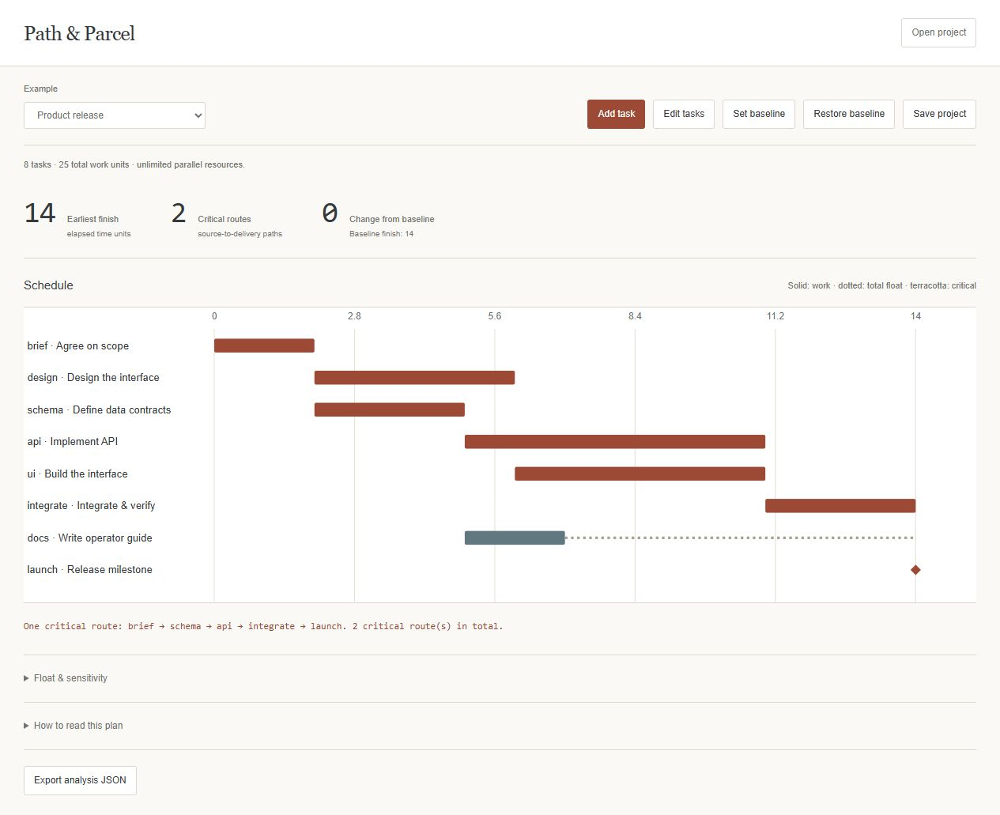

# Path & Parcel

An interactive dependency planner that explains which work determines a delivery date. Edit task cards, inspect earliest/latest schedules, compare a saved baseline, and test whether shortening a task actually shortens the project.



The schedule is the main workspace. Click a task bar, activate it from the keyboard, or use **Edit tasks** to open a single-task editor. **Add task** opens the new record immediately; edits recalculate the plan automatically. Baseline comparison stays above the timeline, while float and sensitivity details expand below it.

## Run

Requires Python 3.10+. No runtime dependencies or API keys.

```sh
python run.py --port 8000
```

Open http://127.0.0.1:8000/. All project calculations run locally in a browser worker. Save project JSON before refreshing; projects and comparison baselines are held in memory.

## Features

- Live task editing with explicit dependency IDs, bounded durations, add/remove operations, and closed cycle witnesses.
- Forward/backward critical-path passes, earliest/latest dates, total float, free float, and an exact count of critical routes.
- Timeline bars, milestone diamonds, slack tails, and a complete schedule ledger.
- One-unit sensitivity analysis: shorten each task separately and recompute the project finish. A critical task on parallel routes can have zero individual benefit.
- Baseline snapshots, finish-date deltas, restoration, JSON import/export, analysis reports, and schedule CSV.

[Example project](docs/example.json) has an API task extended from six to nine units. It finishes at 17 instead of the original 14. The CSV protects formula-like task labels; JSON preserves the original values.

## Scheduling model

Tasks form a directed acyclic graph. Durations are integers from 0 to 10,000; zero-duration milestones are allowed. Dependencies are finish-to-start with no lag. Time starts at zero, resources are unlimited, and unrelated tasks can run concurrently. The app does not model calendars, weekends, resource contention, or uncertain estimates.

Total float measures the margin before a task affects the project finish; free float measures the margin before an immediate successor's earliest start moves. Float values are coupled and cannot all be consumed independently. The latest schedule uses the earliest achievable project finish as its deadline. Critical routes are longest source-to-sink paths, including distinct paths through zero-duration milestones. One representative route is shown; all are counted using BigInt and exported as a decimal string.

JSON files contain a single `tasks` array. Each task has `id`, `label`, `duration`, and `depends`. IDs are stable ASCII names, up to 24 characters. Limits: 64 tasks, 80-character labels, 100 KB imports. Removing a task requires first removing references to it. Invalid edits hide stale results until corrected; invalid imports retain the prior project.

## Verification

Requires Node.js 22+ for tests.

```sh
npm test
npm run check
python -m unittest discover -s tests -p 'test_*.py'
```

Eleven JavaScript tests cover known plans, parallel critical routes, disconnected components, milestones, cycle witnesses, invalid inputs, scenario isolation, and CSV escaping. An independent exhaustive path oracle checks finish dates, critical-task membership, path counts, and total float on 400 generated DAGs. One Python test checks server asset and host boundaries. CI runs on Linux and Windows.

Browser checks verify duration editing, a +3 baseline delay, cycle rejection, restoring the baseline, and saved-project import. Independent Python path enumeration verifies the downloaded report's finish, all total floats, critical-route count, and comparison delta.

## Structure

`core.js` implements validation, topological scheduling, sensitivity, and comparisons. `worker.js` runs the analysis; `app.js` renders task cards and SVG timelines and guards against stale worker responses. The Python server only exposes app assets, without file browsing or a database.
